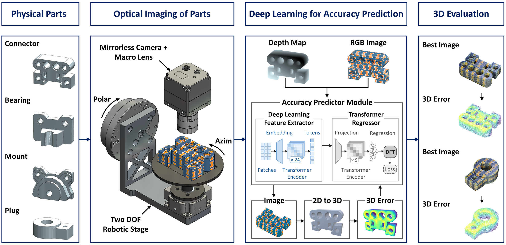

<h1><b>Surface Texture Improves the Dimensional Accuracy of 3D Manufacturing Inspection from a Single Image</b></h1>

<p>Hossein Kabir, Charles T. Whealton, Alex Jiang, Austin F. Martin, Miles V. Bimrose, William P. King*</p>

<p><sub>Grainger College of Engineering, Department of Mechanical Science and Engineering, University of Illinois Urbana-Champaign, Urbana, IL 61801, USA<br>
55th SME North American Manufacturing Research Conference (NAMRC 55), 2027<br>
<sup>*</sup>Corresponding author: wpk@illinois.edu</sub></p>

<p><b>Dataset:</b> <a href="https://www.kaggle.com/datasets/hosseinkabir/surface-texture-dataset">Surface Texture Dataset on Kaggle</a></p>

## Overview

Additive manufacturing (AM) produces complex parts that require accurate and efficient dimensional inspection. Optical scanners provide accurate measurements, but high equipment cost, long acquisition and processing times, limited depth of field, and sensitivity to surface properties can complicate inspection. Generative deep learning models offer a low-cost alternative because they create a three-dimensional (3D) mesh from a single photograph within seconds. The accuracy of these reconstructions depends strongly on what the photograph shows, but the role of surface texture has not been established.

This repository contains the code for a study of how surface texture affects the dimensional accuracy of single-image 3D reconstruction, together with a deep learning model that predicts this accuracy directly from a photograph. Four mechanical parts with different geometries (Connector, Bearing, Mount, Plug) are each manufactured with four surface textures using laser powder bed fusion (L-PBF), PolyJet printing, and fused deposition modeling (FDM). Each part is independently repositioned and scanned six times, with 132 photographs per scan, giving 12,672 images. Every image is reconstructed with Hunyuan3D 2.1 and compared with a reference laser scan. The Accuracy Predictor Module, a DINOv3 feature extractor with a transformer regressor operating on the RGB image and its Depth Anything V2 depth map, then predicts the reconstruction error of each photograph so that the most promising camera view can be selected before 3D reconstruction.

<p align="center">
  
</p>

**Figure 1.** Method for physically accurate single-image 3D reconstruction of AM parts. Four mechanical part designs undergo optical imaging on a two-axis robotic stage with a mirrorless camera and macro lens. The Accuracy Predictor Module, a deep learning feature extractor and a transformer regressor, predicts the surface DFT of the reconstruction generated from each image. The rightmost column shows best images of the Connector and Plug and the laser-scan overlay error of each reconstruction.

## Repository Structure

```
Surface-Texture-3D-Inspection/
├── asset/
│   └── Figure.png                      # Figure 1 of the paper
├── src/
│   ├── hunyuan_reconstruction.ipynb    # Stage 1: background removal + Hunyuan3D 2.1
│   ├── icp_alignment.ipynb             # Stage 2: registration to the laser scan + 3D error
│   ├── depth_anything_v2.ipynb         # Stage 3: image cache + Depth Anything V2 depth maps
│   └── accuracy_predictor.ipynb        # Stage 4: DINOv3 + transformer regressor (RGB / RGB-D)
└── README.md
```

## Dataset

A representative subset of the dataset is available on Kaggle: **[Surface Texture Dataset](https://www.kaggle.com/datasets/hosseinkabir/surface-texture-dataset)**. It contains the 9,504 original photographs (background not removed) of the Connector, Bearing, and Mount in all four surface textures and six repeats, organized in the folder layout below.

| Item | Value |
|---|---|
| Parts | Connector, Bearing, Mount, Plug (largest dimension ≈ 3 cm) |
| Surface textures | Checker (PolyJet), UofI logo (PolyJet), L-PBF (as-built 316L), FDM (blue-gray PLA) |
| Repeats | 6 independent repositionings per part and texture (96 imaging runs) |
| Views per repeat | 132: 12 azimuth angles (0°–330°, 30° steps) × 11 polar angles (0°–70°, 7° steps) |
| Images | 3,168 per part, 12,672 in total (9,504 on Kaggle) |
| Resolution | 2550 × 2550 px, ≈ 7 µm per pixel at the object plane |
| Reference geometry | Hexagon Absolute Arm V3P 8525 with AS1 blue-laser scanner (39 µm accuracy), processed in PolyWorks |

**Fabrication.** FDM parts are printed in PLA on Bambu Lab X1E and H2D printers (0.4 mm nozzle, textured PEI plate, 0.20 mm Standard profile). PolyJet parts are printed on a Stratasys J55 Prime in High-Quality Speed mode, with the Checker and UofI patterns applied to all faces using the SolidWorks texture-wrap tool. L-PBF parts are built in 316L stainless steel on an EOS M290 with standard parameters.

**Imaging.** A two-axis Zaber robotic stage rotates each part through the 132 views and pauses 0.2 s after each move. A Canon EOS R5 Mark II with an RF 100 mm F2.8L Macro lens captures each photograph at a working distance of about 10 cm (ISO 6400, f/16, 1/500 s). A Python interface drives the stage, triggers the camera through Canon EDSDK, and records the stage position of each photograph. One full set of 132 images takes about 40 s.

**Folder layout.**

```
input/
├── raw_images/<Part>/<Texture>/<Repeat>/<ID>_azimuth_<az>_polar_<pol>.jpg
└── stls_gt/{bearing,connector,mount,plug}.stl
```

`<Texture>` is one of `Checkerboard`, `UIUC`, `PBF`, `FDM`, and `<Repeat>` is `1`–`6`.

## Pipeline

- **Stage 1 – Background removal and single-image reconstruction** (`hunyuan_reconstruction.ipynb`)
  BiRefNet (rembg `birefnet-general`) removes the background and composites the part onto white. Near-white pixels define the alpha mask passed to Hunyuan3D 2.1 (`tencent/Hunyuan3D-2.1`, `hunyuan3d-dit-v2-1`), which generates one watertight STL per photograph. Settings: 30 inference steps, octree resolution 300, guidance scale 7.5, dual guidance scale 10.5, seed 1234, batch size 16.

- **Stage 2 – Registration and 3D error** (`icp_alignment.ipynb`)
  Each reconstruction is registered to the laser-scan reference with rotation, translation, and uniform scale:
  1. Both meshes are centered, and the reconstruction is pre-scaled by the ratio of RMS radii.
  2. Candidate rotations come from principal-axis alignment (all proper sign and axis-order variants) and three FPFH + RANSAC estimates.
  3. Every candidate is screened with rigid ICP and ranked by symmetric (bidirectional) inlier fitness.
  4. The best four are refined with multiscale rigid ICP (thresholds 8×, 4×, 2×, 1×, 0.5× voxel).
  5. A uniform-scale correction from matched-point spreads, bounded to 0.83–1.20, is kept if it does not reduce fitness.

  Metrics per reconstruction:
  - **Surface DFT** (`surface_dft_um_mean`, `surface_dft_um_std`): mean and SD of nearest-neighbor distances between 30,000 points sampled on each surface, in both directions, in µm.
  - **Envelope IoU** (`env_iou`): intersection over union of top-down height fields on a 200 × 200 grid.
  - **Volume DFT** (`vol_dft_pct`): absolute difference in enclosed volume, as a percentage of the reference volume.

- **Stage 3 – Image cache and depth maps** (`depth_anything_v2.ipynb`)
  Each background-removed image is cropped to the part's bounding box with an 8% margin, padded to a white square, and resized to 384 × 384. Depth Anything V2 Large (`depth-anything/Depth-Anything-V2-Large-hf`) estimates relative depth, which is resized to 384 × 384 and normalized to [0, 1] per image.

- **Stage 4 – Accuracy Predictor Module** (`accuracy_predictor.ipynb`)
  - **Feature extractor.** DINOv3 ViT-L/16 (`vit_large_patch16_dinov3.lvd1689m`) at 256 × 256, which gives 256 patch tokens, 1 class token, and 4 register tokens of dimension 1024 through 24 encoder blocks. With `CHANNELS = "rgbd"`, the depth map is added as a fourth input channel.
  - **Transformer regressor.** Tokens are projected to 384 dimensions, and a learnable regression token and positional embeddings are added. Nine pre-norm encoder layers follow (8 heads, feed-forward width 768), then a LayerNorm → Linear → GELU → Dropout → Linear head.
  - **Target.** The standardized logarithm of surface DFT, transformed back to µm for evaluation.
  - **Loss.** Mean squared error plus λ(1 − ρ_B), where ρ_B is the in-batch Pearson correlation and λ = 0.3.
  - **Training.** AdamW (weight decay 0.05), batch size 64, 35 epochs, learning rate 1 × 10⁻⁵ for the backbone and 5 × 10⁻⁴ for the head. One-epoch linear warm-up, then cosine decay. bfloat16 mixed precision, gradient clipping at 1.0.
  - **Augmentation.** Up to 5% scaling, 2% translation, and 10% brightness and contrast. No flips or large rotations, because these change the visible geometry and hence the label.
  - **Evaluation.** Leave-one-part-out: train on 9,504 images of three parts and test on 3,168 images of the held-out part (`TEST_PART`). Reports Pearson r, RMSE, and MAE. For each repeat, the selected image is the one with the lowest predicted DFT, and its measured DFT is compared with the best and random images.

## Results

All values below are the direct output of `icp_alignment.ipynb` over the 12,672 reconstructions. Surface DFT is the two-way mean nearest-neighbor distance in µm.

**Camera view dominates reconstruction accuracy.** Surface DFT ranges from 154 to 3,378 µm, with a median of 426 µm. Within each repeat, the median image has 2.1× and the worst image 9.6× the error of the best image. Of the 96 best images, 92 are captured at polar angles between 21° and 63°. Near-vertical views (polar 0°) have a median DFT of 1,250–1,400 µm, compared with 320–340 µm at 49°. Oblique views show the top face, side walls, and holes in one photograph, leaving less hidden geometry for the generative model to infer. Surface DFT and envelope IoU agree with R² = 0.90.

**Best-image surface DFT (µm) by part and surface texture**, mean over six repeats:

| Part | Checker | UofI | L-PBF | FDM |
|---|---|---|---|---|
| Connector | 244 | 242 | 238 | 236 |
| Bearing | 190 | 183 | 195 | 185 |
| Mount | 186 | 201 | 215 | 209 |
| Plug | 181 | 172 | 182 | 175 |
| **All parts** | **200** | **199** | **208** | **201** |

**Surface texture has a small effect on the best achievable accuracy.** Averaged over the four parts, the best-image DFT of the four textures lies within 9 µm (199–208 µm). The texture order changes from part to part, and the differences are similar in size to the variation between repeats (mean SD 10.6 µm). Median DFT at each polar angle is also similar across textures. The camera view, by contrast, changes the error by up to an order of magnitude.

| Texture | Best image (µm) | Random image (µm) | Median DFT (µm) | Median IoU | Median volume DFT (%) |
|---|---|---|---|---|---|
| Checker | 200 | 597 | 433 | 0.852 | 8.9 |
| UofI | 199 | 601 | 421 | 0.858 | 8.8 |
| L-PBF | 208 | 613 | 430 | 0.857 | 8.2 |
| FDM | 201 | 557 | 420 | 0.862 | 8.3 |

Accuracy Predictor results will be added once the leave-one-part-out runs are trained on these labels.

## Requirements

- Linux with an NVIDIA GPU (developed on NVIDIA H200)
- Python 3.10
- PyTorch with CUDA
- [Hunyuan3D-2](https://github.com/Tencent-Hunyuan/Hunyuan3D-2) (`hy3dgen`), cloned next to `src/` and loaded with the `tencent/Hunyuan3D-2.1` weights
- rembg, onnxruntime-gpu
- open3d, trimesh, scipy
- transformers, timm
- numpy, pandas, pillow, opencv-python

```bash
pip install torch torchvision timm transformers "rembg[gpu]" onnxruntime-gpu open3d trimesh scipy numpy pandas pillow opencv-python jupyter
git clone https://github.com/Tencent-Hunyuan/Hunyuan3D-2
```

## Usage

1. Download the images from the [Surface Texture Dataset](https://www.kaggle.com/datasets/hosseinkabir/surface-texture-dataset) on Kaggle and place them under `input/raw_images/` using the folder layout above. Place the reference meshes under `input/stls_gt/`. The Kaggle subset does not include the Plug images or the reference meshes.
2. Run the four notebooks in `src/` in order. Each notebook is a single cell, with its settings defined as constants at the top.
3. In `accuracy_predictor.ipynb`, set `CHANNELS` (`"rgb"` or `"rgbd"`) and `TEST_PART` (`"Connector"`, `"Bearing"`, `"Mount"` or `"Plug"`). Run once per held-out part for leave-one-part-out evaluation.

Outputs are written to `outputs/`:

| Path | Content |
|---|---|
| `outputs/bgr_images/` | Background-removed PNGs (same tree as `raw_images`) |
| `outputs/hunyuan_stls/` | One reconstructed STL per photograph |
| `outputs/volume_surface_error.csv` | `folder_path, image_name, env_iou, vol_dft_pct, surface_dft_um_mean, surface_dft_um_std` |
| `outputs/cache/` | `images_384.npy`, `depth_maps.npy`, `meta.csv` |
| `outputs/runs/<run>/` | `metrics.json`, `ranked_test_predictions.csv`, `checkpoint.pt` |

## Run from command line

```bash
jupyter nbconvert --to notebook --execute --inplace --ExecutePreprocessor.timeout=-1 src/hunyuan_reconstruction.ipynb
jupyter nbconvert --to notebook --execute --inplace --ExecutePreprocessor.timeout=-1 src/icp_alignment.ipynb
jupyter nbconvert --to notebook --execute --inplace --ExecutePreprocessor.timeout=-1 src/depth_anything_v2.ipynb
jupyter nbconvert --to notebook --execute --inplace --ExecutePreprocessor.timeout=-1 src/accuracy_predictor.ipynb
```

## Citation

```bibtex
@inproceedings{kabir2027surfacetexture,
  title     = {Surface Texture Improves the Dimensional Accuracy of 3D Manufacturing Inspection from a Single Image},
  author    = {Kabir, Hossein and Whealton, Charles T. and Jiang, Alex and Martin, Austin F. and Bimrose, Miles V. and King, William P.},
  booktitle = {55th SME North American Manufacturing Research Conference (NAMRC 55)},
  journal   = {Manufacturing Letters},
  year      = {2027}
}
```

Related work: Kabir H, Bimrose MV, Whealton CT, et al. _Deep learning enables 3D manufacturing inspection from a single image._ npj Advanced Manufacturing, 2026 (in press). Code: [Single-Image-3D-Inspection](https://github.com/hosseinkabiruiuc/Single-Image-3D-Inspection)

## Patent

WPK, HK, and MVB are inventors on U.S. patent application 19/815,225, "Image Selection Model for 2D-to-3D Reconstruction", filed September 2026 by The Board of Trustees of the University of Illinois. It relates to the image-selection approach in this repository.

## Contact

Hossein Kabir: hkabir2@illinois.edu<br>
William P. King (corresponding author): wpk@illinois.edu
